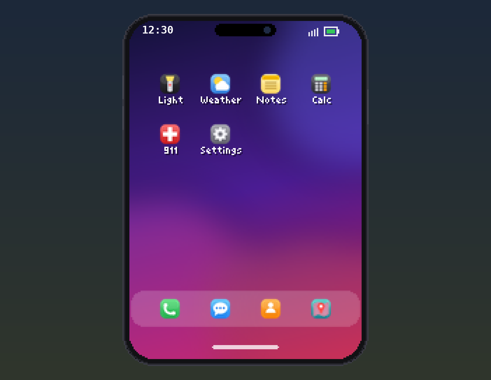
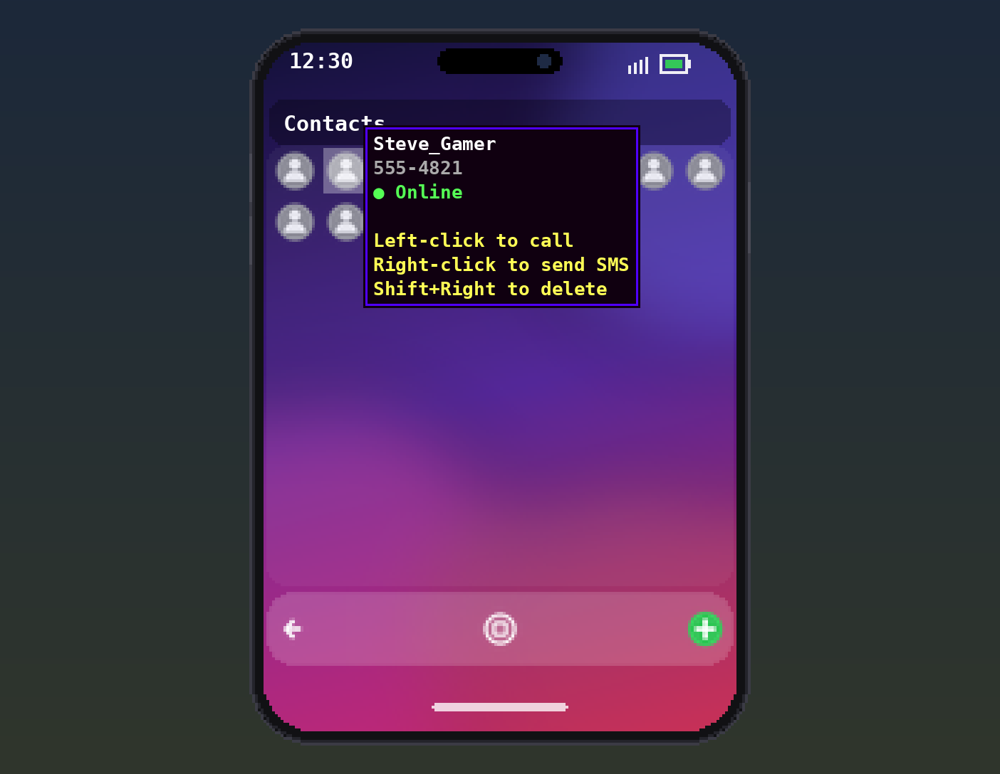
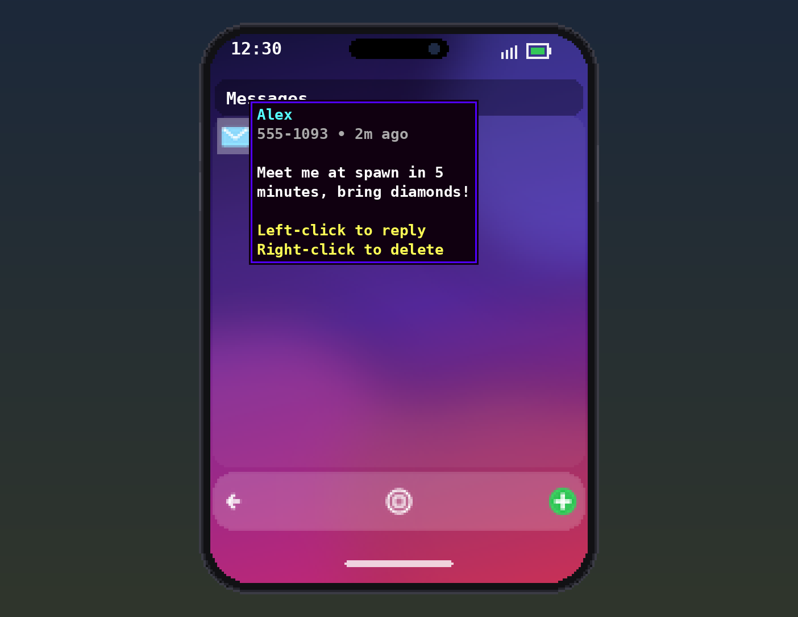
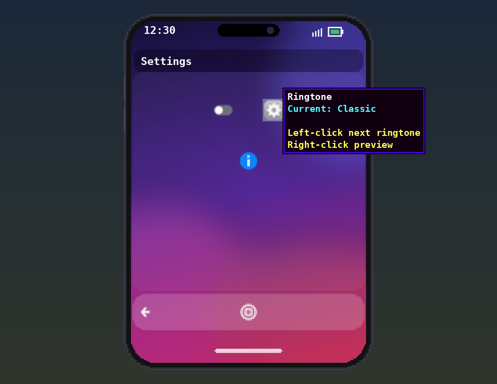
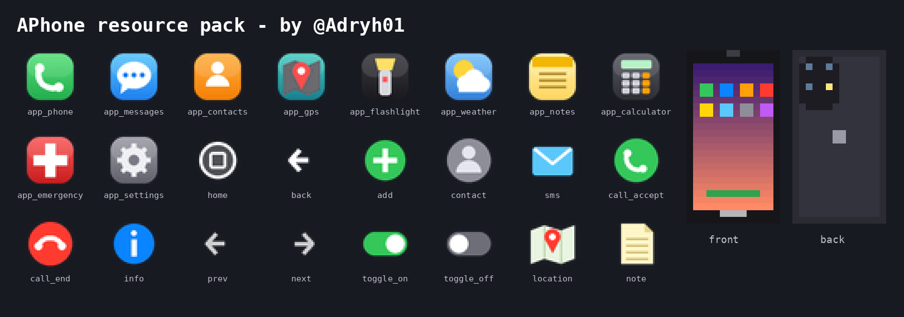

# 📱 APhone — Smartphone for Minecraft 1.21.1

**Made by [@Adryh01](https://github.com/Adryh01)**

A full smartphone for **Paper / Purpur 1.21.1** servers with its own **resource pack**.
The phone uses a **custom 9x5 inventory** fully covered by the phone texture: the player's
own inventory is hidden, you only see the phone — status bar with live clock, a real-phone
**home screen** (app grid with labels + dock at the bottom) and full-screen apps.



## ✨ Features

| App | What it does |
|---|---|
| 📞 **Phone** | Call online players or dial a number. Ringtone, title, clickable **[ACCEPT] / [DECLINE]**, private call chat, live call timer |
| 💬 **Messages** | SMS inbox (works offline too), reply, delete, unread counter |
| 👤 **Contacts** | Save numbers, left-click to call, right-click to text, shift+right to delete |
| 🗺️ **Maps** | Coordinates, biome, facing, **share your location** |
| 🔦 **Flashlight** | Toggles Night Vision |
| ⛅ **Weather** | In-game clock, day counter, weather |
| 📝 **Notes** | Personal notes |
| 🧮 **Calculator** | Type an expression in chat: `12*(3+4)^2` |
| 🚨 **911** | Alerts staff (`aphone.emergency.receive`) with your position, with cooldown |
| ⚙️ **Settings** | Silent mode, 5 ringtones with preview, phone info |

- Every player gets a unique number (e.g. `555-4821`)
- Real-phone home screen: app grid with labels, dock with Phone · Messages · Contacts · Maps
- **Live** status-bar clock
- Player inventory hidden while the phone is open — items are backed up on disk and always given back
  (on close, quit, death, `/reload`, even after a server crash)
- Data saved in `plugins/APhone/players/`

## 🖼️ Previews

| Contacts | Messages |
|---|---|
|  |  |

| Settings | Incoming call |
|---|---|
|  |  |



> Previews are rendered from the real pack textures; in game the text uses the Minecraft font.

## 📦 Installation

1. Download `APhone-1.0.0.jar` and `APhone-ResourcePack.zip` from **Releases** (or **Actions** → latest build → artifacts).
2. Put the jar in `plugins/` and restart (needs **Java 21** + **Paper 1.21.1**).
3. Resource pack — choose one:
   - players put `APhone-ResourcePack.zip` in `.minecraft/resourcepacks`, **or**
   - set `resource-pack.enabled: true` + the zip link in `config.yml` (sent on join).

Without the resource pack set `gui.custom-background: false` (plain chest GUI, vanilla items, inventory not hidden).

## ⌨️ Commands

| Command | Description |
|---|---|
| `/aphone` | Open the phone |
| `/aphone number` | Show your number |
| `/aphone call <number\|player>` | Call someone |
| `/aphone sms <number\|player> <message>` | Send an SMS |
| `/aphone accept` · `decline` · `hangup` | Manage calls |
| `/aphone give [player]` | Give a phone *(aphone.admin)* |
| `/aphone reload` | Reload config & messages *(aphone.admin)* |

Aliases: `/phone`, `/telefono`, `/smartphone`

## 🔐 Permissions

| Permission | Default |
|---|---|
| `aphone.use` | everyone |
| `aphone.emergency.receive` | op |
| `aphone.admin` | op |

## 🛠️ Crafting

```
I G I      I = Iron Ingot
I R I      G = Glass Pane
I I I      R = Redstone
```

## 🧱 Build

GitHub Actions builds everything on every push (`.github/workflows/build.yml`).
Push a tag to publish a release with the jar and the resource pack:

```bash
git tag v1.0.0
git push origin v1.0.0
```

Local build: `mvn package` → `target/APhone-1.0.0.jar`

Regenerate textures / previews (Python + Pillow):

```bash
python3 tools/generate_pack.py
python3 tools/render_previews.py
```

## 🎨 How the full-screen phone works

- The GUI is a **9x5 chest** (45 slots). The title uses font `aphone:gui`: glyph `\uE001` (home) or `\uE000` (apps)
  draws a **176×252** phone starting 24 px above the chest, covering the whole window, player inventory area included
- While the phone is open the player's inventory is saved (`plugins/APhone/backups/`) and emptied, and its slots
  become part of the phone: the 3 inventory rows are extra screen space, the **hotbar row is the dock / bottom bar**.
  Phone icons are tagged and can never leave the phone
- Font `aphone:status` reuses vanilla `ascii.png` to write the live clock in the status bar
- Home app labels are drawn in `phone_home.png` (positions in `tools/generate_pack.py` → `HOME_LABELS`, must match `HomeMenu.java`)
- The resource pack sets `container.inventory` to empty, hiding the vanilla "Inventory" label
- Phone item → `PAPER` + `custom_model_data 1001` (3D model) · icons → `2001…2033` · `pack_format 34`

## 📁 Structure

```
plugin-telefon/
├── .github/workflows/build.yml       # auto build + release
├── pom.xml
├── src/main/java/dev/adryh01/aphone/ # plugin source
├── src/main/resources/               # plugin.yml, config.yml, messages.yml
├── resourcepack/                     # APhone resource pack
├── tools/                            # texture + preview generators
└── docs/previews/                    # screenshots
```

## License

MIT © 2026 **Adryh01** — if you use or edit APhone, keep the credit to @Adryh01.
